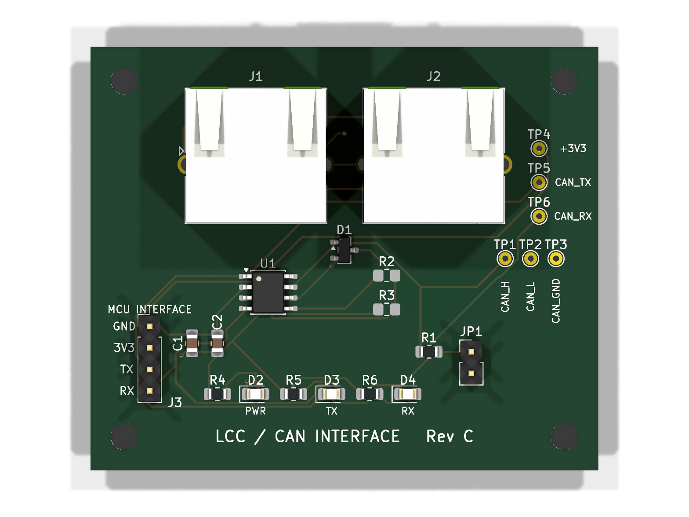

# LCC / CAN interface board – Rev C

A small two-layer board that connects any 3.3 V microcontroller with a CAN
controller (ESP32 TWAI, STM32, …) to an **LCC / OpenLCB** bus using standard
RJ45 cables. Designed in KiCad for model railway layouts; in daily use on my
layout under every LCC node and the Ethernet bridge
([lcc-eth-bridge](https://github.com/honzup/lcc-eth-bridge)).

Why a dedicated board rather than a ready-made transceiver module:

- **RJ45 in and out** – robust connectors and ordinary straight-through patch
  leads; the bus daisy-chains through the board, so unplugging the processor
  doesn't break the bus.
- **Termination by jumper** – fit JP1 only on the boards at the two ends of the
  bus. (Many ready-made SN65HVD230 modules have a 120 Ω resistor soldered on
  permanently.)
- **Test points and LEDs** – probe pads for CAN_H, CAN_L, CAN_GND, 3V3, TX and
  RX, plus power / TX / RX LEDs: you can see at a glance whether the board has
  power, whether the node transmits and whether it hears the bus.
- **ESD protection** on the bus lines (PESD1CAN TVS diode), shields tied to
  CAN ground.
- **TCAN33x footprint** – built with a TCAN332; also takes the TCAN330/334/337.

## Specification

- Transceiver U1: TI **TCAN332DR**, 3.3 V, SOIC-8. LCC's 125 kbit/s is far inside
  its rating.
- J1/J2: Amphenol **RJHSE-5380** shielded RJ45, **no magnetics**. Do not
  substitute an Ethernet MagJack – its transformers block CAN. Not the
  `-5385` (LED) variant either.
- J3: 4-pin 2.54 mm header to the microcontroller: **1 GND, 2 3V3, 3 TX, 4 RX**.
  The board is powered from the microcontroller's 3.3 V – wire GND and 3V3,
  not just TX/RX.
- All eight RJ45 conductors pass straight through J1 ↔ J2. Bus power (pins 7/8)
  is pass-through only and is not connected to the board's supply.
  Non-isolated design.
- 60 × 50 mm, two layers, 1.6 mm, solid CAN_GND pour on the bottom.
  Four M3 mounting holes, 4 mm in from each corner (52 × 42 mm pattern).

### RJ45 pinout (LCC standard S-9.7.1.1)

| Pin | Signal | T568B colour |
|-----|--------|--------------|
| 1 | CAN_H | white/orange |
| 2 | CAN_L | orange |
| 3 | CAN_GND | white/green |
| 4 | ALT_L (pass-through) | blue |
| 5 | ALT_H (pass-through) | white/blue |
| 6 | CAN_GND | green |
| 7 | PWR_NEG (pass-through) | white/brown |
| 8 | PWR_POS (pass-through) | brown |
| shell | CAN_GND | |

CAN_H/CAN_L share one twisted pair, so ordinary **straight-through** Cat5e/Cat6
patch leads work. Never use crossover or flat (untwisted) cable.

## Ordering and assembly

- **PCB:** upload `LCC_Interface_RevC_gerbers.zip` to any fab (JLCPCB, PCBWay …):
  2 layers, 1.6 mm, default settings.
- **Parts:** `BOM.csv` (with Digi-Key part numbers) and `digikey-order.txt`
  (paste into Digi-Key's quick order). `bom/ibom.html` is an interactive BOM –
  open it in a browser while soldering to highlight each part's position.
- **Hand soldering:** all SMD parts are 0805 or SOIC-8/SOT-23 with hand-solder
  pads. R2/R3 are **not fitted** for the TCAN332 – fit them only for a
  TCAN330/334/337, where they hold the mode pins low.
- **Reflow all eight U1 pins.** Cold joints on hand-soldered SOIC-8s tend to
  come in groups; if a fresh board misbehaves, reflow the whole chip rather
  than chasing one pin at a time.
- **LED colours:** the LEDs run from 3.3 V through 1 kΩ. Use red, orange,
  yellow or standard green (≈2 V forward voltage). Blue, white and "true" green
  (≈3 V) are barely visible at this current.

## Bring-up checks

With the board powered and connected to the bus:

| Check | Expect |
|-------|--------|
| PWR LED | on |
| 3V3 test point (TP4) | 3.3 V |
| CAN_H and CAN_L to CAN_GND, bus idle | both ≈ 1.9 V – normal for a 3.3 V transceiver, not the 2.5 V of 5 V parts |
| TX / RX test points, bus idle | ≈ 3.3 V (high = recessive) |
| RX LED | flickers on any bus traffic |
| TX LED | flickers only when *this* node transmits |
| CAN_H ↔ CAN_L, everything powered off | ≈ 60 Ω with both ends terminated; ≈ 120 Ω means only one end |

RX flickering with TX dark means the node hears the bus but isn't transmitting
– check the TX wire and the node firmware.

## Files

| File | What |
|------|------|
| `LCC_Interface.kicad_pro` / `.kicad_sch` / `.kicad_pcb` | KiCad project (made in KiCad 10; the schematic is the source of truth) |
| `LCC_Interface_RevC_gerbers.zip` (+ unzipped folder) | Gerbers and drill files for ordering |
| `BOM.csv`, `digikey-order.txt`, `bom/ibom.html` | Bill of materials, Digi-Key order, interactive BOM |
| `images/` | Renders |

## Revision history

- **Rev C** (current) – adds power / TX / RX LEDs and test points for 3V3, TX
  and RX. No circuit change. Tag `rev-c`.
- **Rev B** – first manufactured version. Common ground between the board and
  the bus, PESD1CAN ESD protection, 4.7 µF bulk capacitor, shielded RJ45s,
  TCAN33x-family footprint. Tag `rev-b`.
- **Rev A** – an AI-drafted schematic whose net labels had landed on the wrong
  pins (TX/RX and CAN_H/CAN_L swapped, RJ45 pinout mirrored) – a reminder to
  check every pin against the datasheets.

## Licence

CERN Open Hardware Licence v2 – Permissive (CERN-OHL-P-2.0) – see `LICENSE`.
